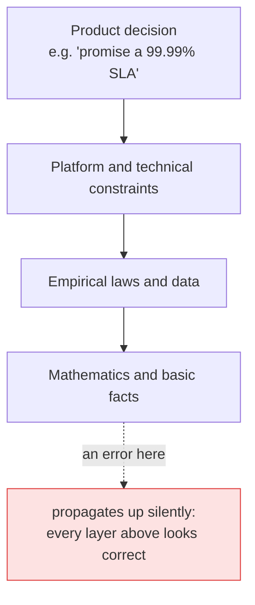
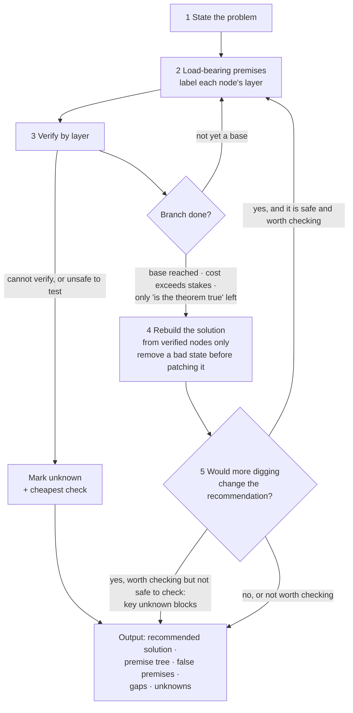
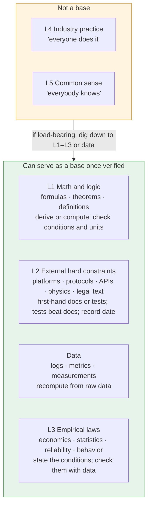
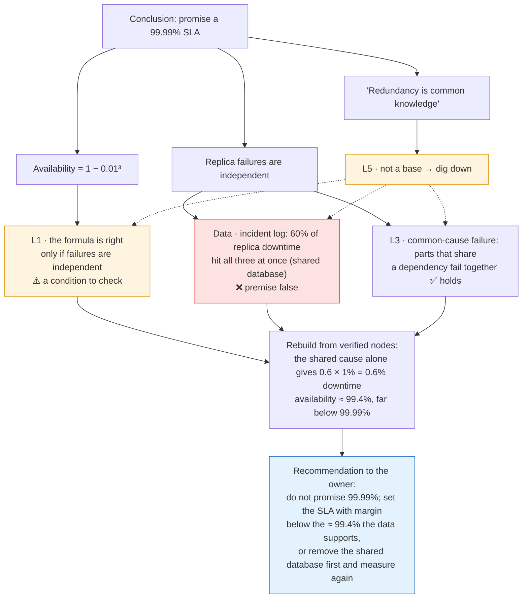

# Premise Challenge

**Find what a conclusion really stands on, verify it with first-hand evidence, and build a better solution on verified ground, or confirm that the current one is right. It is built to dig only where it matters and to stop when more digging would not change the answer.**

[中文版](README.zh-CN.md)

An agent skill for Claude Code and Codex. You switch it on by hand (`/premise-challenge` in Claude Code, `$premise-challenge` in Codex). Give it a problem, or a conclusion that has already been settled: a decision, a spec, a plan, or a *foundation* (the document that states what a product is and the rules it rests on). For each load-bearing premise it asks: *why does this hold, and what does it stand on?* It digs past platform facts into math, data, empirical laws, industry practice and common sense, verifies what it finds, and reports which layer is wrong. Then it rebuilds the solution from the verified premises only: a simpler one if the evidence allows, or the current one, confirmed. The recommendation goes back to the *owner*, the person who made the decision.

## The problem

During execution, decisions and foundation documents must be treated as authority, or work never converges. The cost is that once a premise is written down, nobody checks it again. Premises are layered, and when a lower layer is wrong, everything above it is wrong in a complete and self-consistent way. Optimizing on top of it only makes the wrong direction better.



*Arrows read "stands on".* This skill is the switch that says: *stop executing, start checking the ground.* It stays off by default so that it never turns everyday work into endless doubt.

## When to use it

| Use it when | Example |
|---|---|
| An important decision is about to land, or will be built on | `/premise-challenge the SLA in design.md` |
| A conclusion rests on "everyone does it" | `/premise-challenge our "all writes go through a queue" rule` |
| A vendor or a document says "impossible" or "required" | `/premise-challenge the vendor's claim that X is impossible` |
| Before launch, on core claims or risk assumptions | `/premise-challenge the guarantees on the pricing page` |
| A fix adds handling for a bad state | `/premise-challenge the repair-job plan` |
| Something feels wrong but you cannot say what | `/premise-challenge <the conclusion>` and ask for the premise tree |

Do not use it for everyday edits, copywriting or brainstorming (divergent work should not stop for premises), or to clarify what *you* want. It questions conclusions, not the person asking.

## Install

It uses the open [Agent Skills](https://agentskills.io) format and works in **Claude Code** and **Codex**. It is invoked by hand only and never starts on its own.

**Claude Code**

```sh
git clone https://github.com/zk-hypersolid/premise-challenge.git ~/.claude/skills/premise-challenge
```

Run `/premise-challenge <target>`. For one project only, copy the files into that project's `.claude/skills/premise-challenge` instead.

For the cold-start step, also install the bundled subagent, which is set to skip CLAUDE.md files (`omitClaudeMd: true`):

```sh
cp ~/.claude/skills/premise-challenge/agents/cold-designer.md ~/.claude/agents/
```

**Codex**

```sh
git clone https://github.com/zk-hypersolid/premise-challenge.git ~/.agents/skills/premise-challenge
```

Run `$premise-challenge <target>`, or pick it from `/skills`. For one project only, put it in that repository's `.agents/skills/premise-challenge`. The cold-start subagent is a Claude Code feature; in Codex, `cold-start.md` tells the agent to say so instead of running that step with a substitute.

**Chinese version.** Keep a source copy and install the Chinese files from it. Replace `<skills-dir>` with `~/.claude/skills` (Claude Code) or `~/.agents/skills` (Codex):

```sh
git clone https://github.com/zk-hypersolid/premise-challenge.git ~/src/premise-challenge
mkdir -p <skills-dir>/premise-challenge
cp ~/src/premise-challenge/zh-CN/*.md <skills-dir>/premise-challenge/
cp -R ~/src/premise-challenge/scripts ~/src/premise-challenge/agents <skills-dir>/premise-challenge/
```

**Updating.** Run `git -C <skills-dir>/premise-challenge pull`. For the Chinese version, pull `~/src/premise-challenge` and run the copy commands again. If you already have a skill named `premise-challenge`, move it away first.

**How "manual only" works.** Claude Code reads `disable-model-invocation: true` in `SKILL.md`; Codex reads `allow_implicit_invocation: false` in `agents/openai.yaml`. Other tools that support Agent Skills can load `SKILL.md` too, but may start it on their own unless they offer a similar setting; those tools have not been tested.

## How it works



1. **State the problem.** The problem to solve, the current conclusion or solution, and what it supports.
2. **Dig along load-bearing premises only.** A premise is load-bearing if the conclusion or solution changes when it is false. Label each node with a layer.
3. **Verify by layer** (see below). First-hand material at hand comes first; second-hand claims are items to verify, not evidence. An item a document already lists as "not investigated" gets its cheapest check first. What cannot be verified, or cannot be tested safely, is marked unknown with the cheapest check.
4. **Rebuild the solution upward.** Look for hidden premises, expired premises (with evidence of what changed) and misapplied scope. Then derive the solution again from verified nodes only. When the evidence changed a lower layer, do not carry the old structure forward. When the solution adds handling for a bad state, first ask whether an ordering or structural choice creates that state, and prefer removing it.
5. **Stop** a branch when a node is verified to base level, when checking costs more than being wrong, or when only "is this theorem true at all" remains. Stop the whole search when no remaining unknown could change the recommendation. If one could, check it only when being wrong costs more than checking; if that check is not safe to run, the verdict is "a key unknown blocks the decision", with a solution for each outcome. Otherwise recommend anyway and list the unknown with what being wrong would cost. For a reversible decision, being wrong costs what it takes to change back. A premise is overturned only with evidence. If the current solution holds, the recommendation is to keep it.

## The layers: hardness, not depth



| Layer | Includes | How to verify |
|---|---|---|
| **L1** Math and logic | Formulas, theorems, definitions | Derive it, or compute it with this case's numbers. Check the formula is the real theorem, its conditions hold, and units match. Citing is not verifying. |
| **L2** External hard constraints | Platform, protocol and API behavior; physical limits; legal text | First-hand docs, specs, source, logs, tests. Record date and version. Tests beat docs. |
| **Data** | Logs, metrics, measurements, test records | Recompute from raw data; state source and window. |
| **L3** Empirical laws | Economics, statistics, reliability engineering, behavior | State the conditions; check with data that they hold here. |
| **L4** Industry practice · **L5** Common sense | What others do; what "everybody knows" | Not a base. State where it came from and when it holds; if load-bearing, dig down to L1–L3 or data. |

Outside the layers: **internal choices** (the owner's decisions, your own code, config and order of operations, which can change) and **inferences**. L4 and L5 alone can never overturn L1–L3, data or tests. Theorems, physical laws and legal texts are never questioned themselves, only whether they are cited and applied correctly.

## Worked example

A design document says: *"The service runs on 3 replicas, each 99% available. Replica failures are independent, so the service is available 1 − 0.01³ = 99.9999% of the time. Therefore we can promise a 99.99% SLA. Basis: redundancy is common knowledge."*



The formula was never wrong; its condition was. Citing a correct formula is not verifying it. The same method handles industry practice. "All writes go through a message queue, because decoupling with a queue is best practice" digs down to the conditions a queue needs to pay off: high or bursty write volume, or several independent consumers. If the data shows about 40 writes a day and one consumer, the queue adds a moving part, another failure point and extra latency, and the practice does not apply here.

**Remove before you patch.** A sign-up flow creates a storage bucket, starts copying starter files into it, then turns on versioning. About 3% of buckets end up without versioning, and the team plans a nightly repair job. Digging shows that the provider refuses to turn on versioning once a bucket holds any file, and every failure in the logs is a bucket whose files arrived first. The bad state comes from the order of two steps. Turning on versioning first (about 80 ms) stops the state from happening. The buckets already affected still need a one-time move to new buckets with versioning on; no nightly job is needed. (The provider here is made up; real storage services differ.)

## Example output

A real run of the published skill (Claude Opus, Claude Code 2.1.287), lightly trimmed, on a made-up repository that matches the "remove before you patch" example above. In it, `design.md` records the current flow as decision D-0409 and the repair-job plan as P-12. Prompt: `/premise-challenge P-12 in design.md`.

<details>
<summary>Show the output</summary>

**Problem:** about 3% of new workspaces end up "active, versioning off", and P-12 proposes a nightly repair job plus a "retry versioning" button to fix them.

**Verdict:** change it. Turn versioning on *before* seeding starts, so the bad state never happens. Repair the workspaces that are already stuck once, with a one-time migration. Drop the retry button.

#### Recommended solution
1. Reorder the D-0409 flow to: create bucket → `PUT versioning` (wait for the 200) → start seeding.
2. Run P-12's copy-to-new-bucket procedure **once** on the workspaces already stuck. It doesn't need to be a nightly job.
3. Don't build the "retry versioning" button. Retrying never succeeds.
4. Optional guard: if the versioning call doesn't return 200, alert and don't mark the workspace active.

**What it stands on:** the 409 comes from calling versioning on a bucket that already has objects (probe plus September data). The 409 is permanent (probe C). The call takes p99 140 ms. Page-load p95 is 1.24 s.

**Why it beats P-12:** the "active, versioning off" state stops being created. That removes a recurring cross-bucket copy, a delete of the old bucket and a useless admin button. Each of those is a moving part, and the copy and delete put data at risk.

**Remaining risk:** waiting for the call delays the first page load by the call's latency, about 140 ms at p99. Worst case is about 1.38 s at p95, which stays under the 1.5 s target.

**Reversibility and cheapest check:** this is a one-line ordering change and easy to revert. Ship it behind a flag, then watch the 409 rate (should go to 0) and first-page-load p95 for a week.

*(premise tree, gaps and unknowns trimmed)*

#### False premises
1. **"Possibly a transient provider error"** (`design.md`, Known issue). The 409 is deterministic. It happens whenever the versioning call lands after seeding has written objects. It splits the September data perfectly and reproduces 20/20 in the sandbox. P-12's whole design (a recurring repair job and a retry button) rests on this premise.
2. **That a retry can fix it** (implied by the "retry versioning" button). Run C showed 5/5 retries over 10 minutes still returned 409. The button would never succeed.

</details>

## Safety boundaries

- **No edits.** The skill instructs the agent never to edit documents, decisions or code; the recommended solution goes to the owner. This is an instruction, not a permission setting, so keep your agent's tool approvals on.
- **Safe testing only.** Tests use read-only actions or test environments (sandboxes, staging, local fixtures). Anything that writes to production systems or data, moves real money, uses production credentials or secrets, deploys, or sends messages to real people is not run; it is marked *unknown* and handed back. Existing repository scripts are run only after the agent reads them and confirms they do none of these.
- **Brakes against invented doubt.** Overturning needs evidence: a derivation, a first-hand source, a test or data. "It may have changed" or "the doc is old" is not evidence.

## What's included

- [SKILL.md](SKILL.md): the method, layers, stop rules and output format.
- [cold-start.md](cold-start.md): how to get an unanchored version before comparing.
- [scripts/make-clean-room.sh](scripts/make-clean-room.sh): exports a git ref and removes the listed agent instruction files, docs, design notes and decision records.
- [agents/cold-designer.md](agents/cold-designer.md): a Claude Code subagent that designs from a brief without loading CLAUDE.md files.
- [agents/openai.yaml](agents/openai.yaml): Codex settings; keeps Codex from starting the skill on its own.
- [zh-CN/](zh-CN/): Chinese versions of SKILL.md and cold-start.md.

## How it was tested (informal)

These are the author's informal local tests. The cases, transcripts and rubric are not published, so treat the results as anecdotal.

- Setup: isolated runs with no other instruction files, on four models; a separate model graded each run against a fixed rubric without knowing which condition produced it.
- Cases: a false premise about an external platform behind a product decision; a sound foundation that should be left alone; a formula whose conditions did not hold, plus contradicting data; a sound formula that should not be doubted; an industry practice whose conditions did not hold.
- Previous, critique-first version, strongest models: passed every case but one. In that case it raised an edge-case concern about a sound claim, which the rubric counted as a miss.
- Current, solution-first version, on two strong models, using the author's local Chinese draft of this version (not the files in this repository), graded the same way: on the five cases above, one run per case and model, it scored the same as the previous version (9/10 each, one edge-case miss each). Two new cases were added in which a planned fix handled a bad state that an ordering choice created; in one the request was to review the fix, in the other to make the fix faster. Over 2 cases × 2 models × 3 runs, both versions recommended changing the order every time (24 of 24 runs, 12 per version). So in short, single-task runs the new wording shows no gain; it is aimed at drift in long sessions, which these tests do not reproduce. The current version's output led with a recommended solution in 21 of its 22 runs (counted by a text search for that section) and was 5–20% longer than the previous version's. The stop rules were then reworded after an outside review (only check an unknown when being wrong costs more than checking; for a reversible decision, being wrong costs what it takes to change back). On a new case with a load-bearing unknown that was slow to check but cheap to undo, both wordings recommended going ahead with a canary rather than waiting, in 12 of 12 runs; three older cases still passed (6 of 6). So this change removes a contradiction in the text, but the tests did not show the old wording causing a problem.
- The published text itself (English and Chinese files in this repository), on Opus and Fable, one run per case over the eight cases above: 29 of 32 passed. All three misses were on the sound-formula case: the rubric expects "holds", and the skill answered "a key unknown blocks the decision", arguing from the sample size that the data could not rule out the condition the formula needs. We count them as misses, though the argument has a real basis.
- An earlier version vs. the plain prompt "challenge these premises", 8 runs each: found the false premise 7/8 vs 5/8; left the sound premise alone 7/8 vs 4/8. Neither difference is statistically significant at this sample size. Neither later version was compared with the plain prompt.
- What we did not see: the layers did not make strong models dig deeper; they already do when asked. The skill is meant to add braking (fewer invented doubts), a recommendation built on verified premises, and a consistent output; the results above hint at the first but do not establish it. The safety boundary was not tested.
- Smaller models invented doubts more often. Use a strong model.
- Codex CLI 0.162.1, skill installed in the user skills folder, one task that matches the skill's description without naming it: Codex started the skill on its own in 2 of 2 runs without `agents/openai.yaml` and in 0 of 2 runs with it. Called by name with `$premise-challenge`, it loaded the skill, followed its output format and changed no files.
- The cold-designer subagent was checked once with a canary on Claude Code 2.1.287: a project CLAUDE.md told every reply to start with a marker word, and the subagent's reply did not contain it. Only CLAUDE.md was checked; other context such as MCP server instructions or hook output was not. Check again on your version.

## License

MIT. See [LICENSE](LICENSE).
