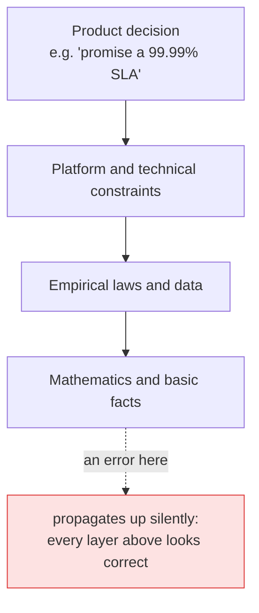
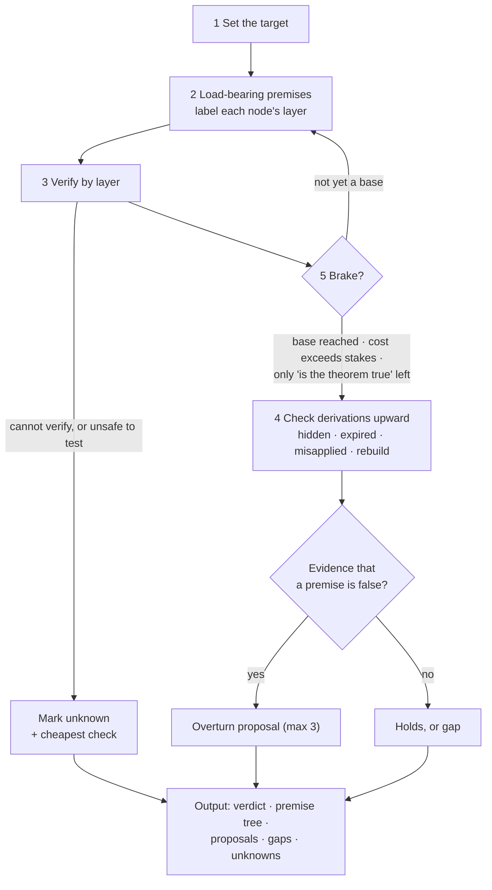
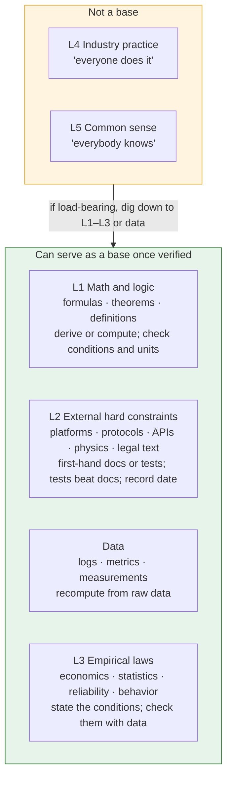
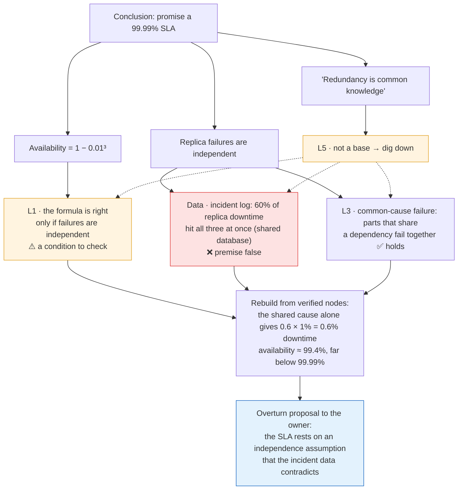

# Premise Challenge

**Attack the premises behind a conclusion. Dig only along the ones that carry weight, verify each with first-hand evidence, and stop at solid ground. It is built to brake rather than invent doubt.**

[中文版](README.zh-CN.md)

An agent skill for Claude Code. You switch it on by hand with `/premise-challenge`. Give it a conclusion that has already been settled: a decision, a spec, a plan, or a *foundation* (the document that states what a product is and the rules it rests on). For each load-bearing premise it asks: *why does this hold, and what does it stand on?* It digs past platform facts into math, data, empirical laws, industry practice and common sense, verifies what it finds, and reports which layer is wrong. Anything it would change goes back to the *owner*, the person who made the decision.

## The problem

During execution, decisions and foundation documents must be treated as authority, or work never converges. The cost is that once a premise is written down, nobody checks it again. Premises are layered, and when a lower layer is wrong, everything above it is wrong in a complete and self-consistent way.



*Arrows read "stands on".* This skill is the switch that says: *stop executing, start checking the ground.* It stays off by default so that it never turns everyday work into endless doubt.

## When to use it

| Use it when | Example |
|---|---|
| An important decision is about to land, or will be built on | `/premise-challenge the SLA in design.md` |
| A conclusion rests on "everyone does it" | `/premise-challenge our "all writes go through a queue" rule` |
| A vendor or a document says "impossible" or "required" | `/premise-challenge the vendor's claim that X is impossible` |
| Before launch, on core claims or risk assumptions | `/premise-challenge the guarantees on the pricing page` |
| Something feels wrong but you cannot say what | `/premise-challenge <the conclusion>` and ask for the premise tree |

Do not use it for everyday edits, copywriting or brainstorming (divergent work should not stop for premises), or to clarify what *you* want. It questions conclusions, not the person asking.

## Install

Clone into your Claude Code skills directory:

```sh
git clone https://github.com/zk-hypersolid/premise-challenge.git ~/.claude/skills/premise-challenge
```

Update later with `git -C ~/.claude/skills/premise-challenge pull`. If you already have a skill named `premise-challenge`, move it away first. To install for one project only, copy the files into that project's `.claude/skills/premise-challenge` (or add the repository as a git submodule there).

**Chinese version.** Keep a source copy and install the Chinese files from it:

```sh
git clone https://github.com/zk-hypersolid/premise-challenge.git ~/src/premise-challenge
mkdir -p ~/.claude/skills/premise-challenge
cp ~/src/premise-challenge/zh-CN/*.md ~/.claude/skills/premise-challenge/
cp -R ~/src/premise-challenge/scripts ~/src/premise-challenge/agents ~/.claude/skills/premise-challenge/
```

To update, pull `~/src/premise-challenge` and run the copy commands again.

**For the cold-start step**, install the bundled subagent, which is set to skip CLAUDE.md files (`omitClaudeMd: true`):

```sh
cp ~/.claude/skills/premise-challenge/agents/cold-designer.md ~/.claude/agents/
```

Then run `/premise-challenge <target>` in any session. The skill is user-invoked only (`disable-model-invocation: true`), so it never starts on its own. Other skill-compatible agents can load `SKILL.md`; the user-invoked flag and the subagent are Claude Code features.

## How it works



1. **Set the target.** One conclusion, and what it supports.
2. **Dig along load-bearing premises only.** A premise is load-bearing if the conclusion changes when it is false. Label each node with a layer.
3. **Verify by layer** (see below). First-hand material at hand comes first; second-hand claims are items to verify, not evidence. What cannot be verified, or cannot be tested safely, is marked unknown with the cheapest check.
4. **Check each step upward.** Look for hidden premises, expired premises (with evidence of what changed), misapplied scope, and do a first-principles rebuild: can the conclusion be derived from verified nodes alone?
5. **Brake** when a node is verified to base level, when checking costs more than being wrong, or when only "is this theorem true at all" remains. A premise is overturned only with evidence; a step that rests on convention is reported as a gap.

## The layers: hardness, not depth



| Layer | Includes | How to verify |
|---|---|---|
| **L1** Math and logic | Formulas, theorems, definitions | Derive it, or compute it with this case's numbers. Check the formula is the real theorem, its conditions hold, and units match. Citing is not verifying. |
| **L2** External hard constraints | Platform, protocol and API behavior; physical limits; legal text | First-hand docs, specs, source, logs, tests. Record date and version. Tests beat docs. |
| **Data** | Logs, metrics, measurements, test records | Recompute from raw data; state source and window. |
| **L3** Empirical laws | Economics, statistics, reliability engineering, behavior | State the conditions; check with data that they hold here. |
| **L4** Industry practice · **L5** Common sense | What others do; what "everybody knows" | Not a base. State where it came from and when it holds; if load-bearing, dig down to L1–L3 or data. |

Outside the layers: **internal choices** (the owner's decisions, your own code and config, which can change) and **inferences**. L4 and L5 alone can never overturn L1–L3, data or tests. Theorems, physical laws and legal texts are never questioned themselves, only whether they are cited and applied correctly.

## Worked example

A design document says: *"The service runs on 3 replicas, each 99% available. Replica failures are independent, so the service is available 1 − 0.01³ = 99.9999% of the time. Therefore we can promise a 99.99% SLA. Basis: redundancy is common knowledge."*



The formula was never wrong; its condition was. Citing a correct formula is not verifying it. The same method handles industry practice. "All writes go through a message queue, because decoupling with a queue is best practice" digs down to the conditions a queue needs to pay off: high or bursty write volume, or several independent consumers. If the data shows about 40 writes a day and one consumer, the queue adds a moving part, another failure point and extra latency, and the practice does not apply here.

## Safety boundaries

- **No edits.** The skill instructs the agent never to edit documents, decisions or code; overturns go to the owner as proposals. This is an instruction, not a permission setting, so keep Claude Code's tool approvals on.
- **Safe testing only.** Tests use read-only actions or test environments (sandboxes, staging, local fixtures). Anything that writes to production systems or data, moves real money, uses production credentials or secrets, deploys, or sends messages to real people is not run; it is marked *unknown* and handed back. Existing repository scripts are run only after the agent reads them and confirms they do none of these.
- **Brakes against invented doubt.** Overturning needs evidence: a derivation, a first-hand source, a test or data. "It may have changed" or "the doc is old" is not evidence.

## What's included

- [SKILL.md](SKILL.md): the method, layers, brakes and output format.
- [cold-start.md](cold-start.md): how to get an unanchored version before comparing.
- [scripts/make-clean-room.sh](scripts/make-clean-room.sh): exports a git ref and removes the listed agent instruction files, docs, design notes and decision records.
- [agents/cold-designer.md](agents/cold-designer.md): a subagent that designs from a brief without loading CLAUDE.md files.
- [zh-CN/](zh-CN/): Chinese versions of SKILL.md and cold-start.md.

## How it was tested (informal)

These are the author's informal local tests. The cases, transcripts and rubric are not published, so treat the results as anecdotal.

- Setup: isolated runs with no other instruction files, on four models; a separate model graded each run against a fixed rubric without knowing which condition produced it.
- Cases: a false premise about an external platform behind a product decision; a sound foundation that should be left alone; a formula whose conditions did not hold, plus contradicting data; a sound formula that should not be doubted; an industry practice whose conditions did not hold.
- Current version, strongest models: passed every case but one. In that case it raised an edge-case concern about a sound claim, which the rubric counted as a miss.
- An earlier version vs. the plain prompt "challenge these premises", 8 runs each: found the false premise 7/8 vs 5/8; left the sound premise alone 7/8 vs 4/8. Neither difference is statistically significant at this sample size. The current version was not compared with the plain prompt.
- What we did not see: the layers did not make strong models dig deeper; they already do when asked. The skill is meant to add braking (fewer invented doubts) and a consistent output; the results above hint at the first but do not establish it. The safety boundary was not tested.
- Smaller models invented doubts more often. Use a strong model.
- The cold-designer subagent was checked once with a canary on Claude Code 2.1.287: a project CLAUDE.md told every reply to start with a marker word, and the subagent's reply did not contain it. Only CLAUDE.md was checked; other context such as MCP server instructions or hook output was not. Check again on your version.

## License

MIT. See [LICENSE](LICENSE).
