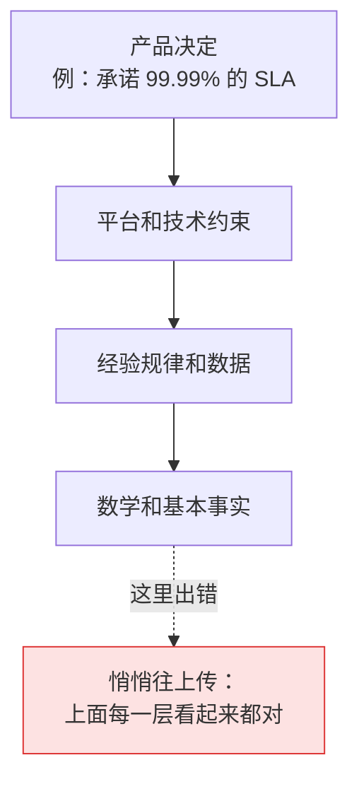
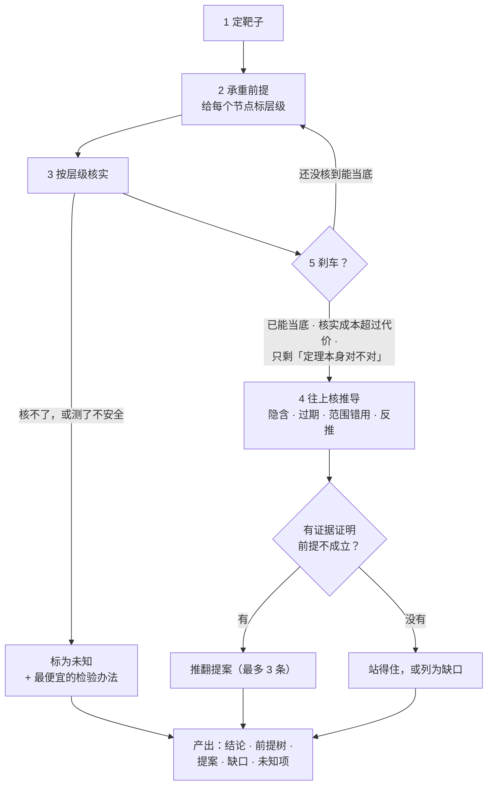
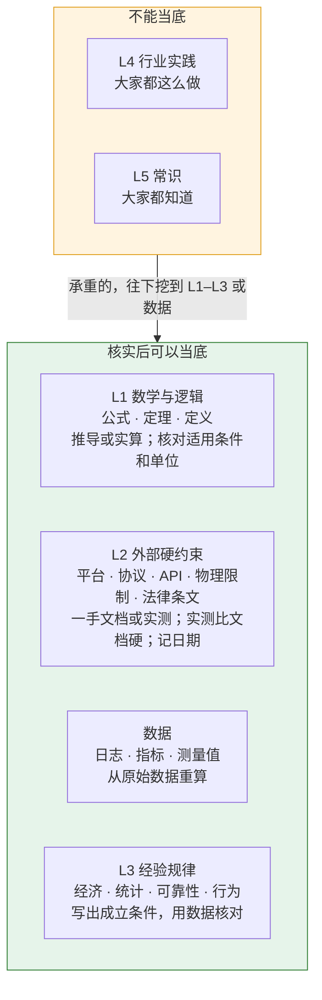
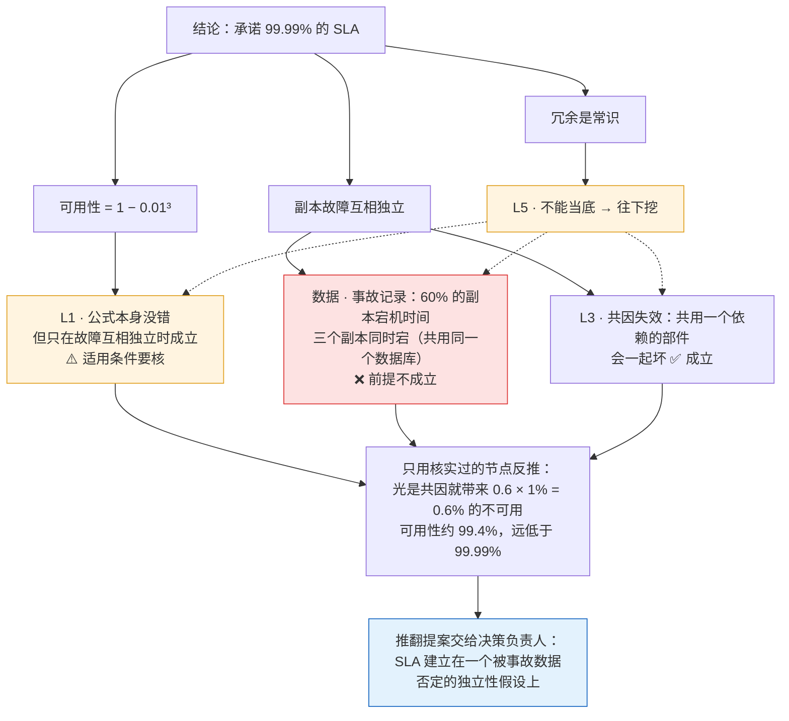

# 前提挑战（Premise Challenge）

**攻击一个结论所依赖的前提。只沿真正承重的前提往下挖，每一层用一手证据核实，挖到实处就停。它的设计目标是该停就停，不硬造疑点。**

[English](README.md)

一个 Claude Code 技能，用 `/premise-challenge` 手动开启。给它一个已经定下来的结论：一个决策、一份规格、一个方案，或者一份 *foundation*（写明一个产品是什么、建立在哪些规则之上的基础文档）。它对每条承重前提追问：*它凭什么成立？它又站在什么上？* 它会越过平台事实继续往下挖，挖到数学、数据、经验规律、行业实践和常识，逐层核实，最后告诉你错在哪一层。凡是它认为要改的，都交回给*决策负责人*，也就是当初做这个决定的人。

## 解决什么问题

执行时，决策和 foundation 文档必须被当作权威，否则工作永远没法收敛。代价是：前提一旦写进去，就没人再验证。而前提是分层的，下层一错，上层会跟着错得很完整、很自洽。



*箭头读作"站在……之上"。* 这个技能就是一个开关，意思是：*先别往下做，回头检查地基。* 它默认关闭，免得把日常工作变成无休止的质疑。

## 什么时候用

| 适合 | 例子 |
|---|---|
| 重要决定要落地，或者要在它上面继续做 | `/premise-challenge design.md 里的 SLA` |
| 结论靠"大家都这么做"撑着 | `/premise-challenge "写操作一律走队列"这条规则` |
| 供应商或文档说"做不到""必须这样" | `/premise-challenge 供应商说 X 做不到的说法` |
| 上线前，检查核心说法或风险假设 | `/premise-challenge 定价页上的承诺` |
| 直觉觉得哪里不对，又说不出来 | `/premise-challenge <那个结论>`，并让它摊开前提树 |

不适合：日常改代码、写文案、脑暴（发散阶段不该被前提卡住）；也不适合用来理清*你自己*想要什么。它质疑的是结论，不是提问的人。

## 安装

克隆到 Claude Code 的技能目录：

```sh
git clone https://github.com/zk-hypersolid/premise-challenge.git ~/.claude/skills/premise-challenge
```

以后用 `git -C ~/.claude/skills/premise-challenge pull` 更新。如果已经有一个叫 `premise-challenge` 的技能，先把它移走。只想给某个项目用，就把文件复制到那个项目的 `.claude/skills/premise-challenge`（或者在那里把本仓库加成 git submodule）。

**中文版**：留一份源码副本，从里面装中文文件：

```sh
git clone https://github.com/zk-hypersolid/premise-challenge.git ~/src/premise-challenge
mkdir -p ~/.claude/skills/premise-challenge
cp ~/src/premise-challenge/zh-CN/*.md ~/.claude/skills/premise-challenge/
cp -R ~/src/premise-challenge/scripts ~/src/premise-challenge/agents ~/.claude/skills/premise-challenge/
```

更新时，先在 `~/src/premise-challenge` 里 pull，再把上面的复制命令跑一遍。

**冷启动步骤要用**：安装附带的 subagent，它被设置为不加载 CLAUDE.md 文件（`omitClaudeMd: true`）：

```sh
cp ~/.claude/skills/premise-challenge/agents/cold-designer.md ~/.claude/agents/
```

之后在任意会话里输入 `/premise-challenge <靶子>` 即可。这个技能只能由用户手动调用（`disable-model-invocation: true`），不会自己启动。其他支持技能的 agent 也可以加载 `SKILL.md`；"只能由用户调用"和 subagent 是 Claude Code 的功能。

## 它怎么工作



1. **定靶子**：只攻击一个结论，写清它支撑什么。
2. **只沿承重前提往下挖**：承重前提指，它不成立，结论就会变。给每个节点标层级。
3. **按层级核实**（见下）：先读手边的一手资料；二手说法是待核项，不是证据。核不了的、或者没法安全地测的，标为未知，并写出最便宜的检验办法。
4. **往上核每一步推导**：找隐含前提、过期前提（要拿出"具体变了什么"的证据）、范围错用；再做第一性原理反推：只用核实过的节点，能不能推出这个结论？
5. **刹车**：节点核到能当底就停；核实成本超过这条前提错了的代价就停；只剩"定理本身对不对"这类问题时也停。只有拿到证据才推翻前提；靠惯例撑着的那一步，列为缺口。

## 层级：表示硬度，不表示深度



| 层 | 包括 | 怎么核 |
|---|---|---|
| **L1** 数学与逻辑 | 公式、定理、定义 | 自己推一遍，或代入本例的数字实算。核对引用的公式是不是那个定理本身、条件是否满足、单位是否一致。只引用不算核过。 |
| **L2** 外部硬约束 | 平台、协议、API 的实际行为；物理限制；法律条文 | 一手文档、规范、源码、日志、实测。记下日期和版本。实测比文档硬。 |
| **数据** | 日志、指标、测量值、实测记录 | 从原始数据重算，注明来源和区间。 |
| **L3** 经验规律 | 经济学、统计学、可靠性工程、行为规律 | 写出成立条件，用数据核对我们是否满足。 |
| **L4** 行业实践 · **L5** 常识 | 别人的做法、"大家都知道" | 不能当底。写出出处和适用条件；承重的，往下挖到 L1–L3 或数据。 |

不在层里的节点：**内部选择**（决策负责人拍板的事，以及我们自己的代码和配置，它们可以改）和**推断**。L4、L5 单独永远不能推翻 L1–L3、数据或实测。不质疑定理、物理定律和法律条文本身，只核对它们有没有被正确引用和使用。

## 一个完整的例子

某份设计文档写着：*"服务跑在 3 个副本上，每个副本可用性 99%。副本故障互相独立，所以服务可用性是 1 − 0.01³ = 99.9999%。因此可以承诺 99.99% 的 SLA。依据：冗余是常识。"*



公式从来没错，错的是它的适用条件。引用一个正确的公式不等于核过它。同样的方法也能挖开行业实践。"所有写操作都走消息队列，因为用队列解耦是最佳实践"，挖下去会落到队列值得用的条件上：写入量大或波动大，或者有多个独立的消费方。如果数据显示每天只有 40 次左右的写入、只有一个消费方，队列只会多一个环节、多一个故障点和额外的延迟，这条实践在这里就不适用。

## 安全边界

- **不改东西**：技能要求 agent 不改任何文档、决策或代码，推翻提案交给决策负责人。这是一条指令，不是权限设置，所以请保持 Claude Code 的工具审批开着。
- **只做安全的实测**：只用只读操作，或者在测试环境里做（沙箱、预发环境、本地样例数据）。会写生产系统或生产数据、动真实资金、用生产凭证或密钥、做部署、给真实用户发消息的，一律不跑，标为*未知*交还给你。仓库里已有的脚本，agent 要先读过、确认不做这些事才会跑。
- **防止硬造疑点**：推翻必须带证据，即推导、一手来源、实测或数据。"可能已经改了""文档很旧了"都不算证据。

## 包含什么

- [SKILL.md](SKILL.md)：方法、层级、刹车和产出格式。
- [cold-start.md](cold-start.md)：怎么先得到一版不受锚定的方案，再做对比。
- [scripts/make-clean-room.sh](scripts/make-clean-room.sh)：导出一个 git ref，并删掉清单里列出的 agent 指令文件、文档、设计说明和决策记录。
- [agents/cold-designer.md](agents/cold-designer.md)：只根据 brief 做设计、不加载 CLAUDE.md 文件的 subagent。
- [zh-CN/](zh-CN/)：SKILL.md 和 cold-start.md 的中文版。

## 怎么测的（非正式）

以下是作者在本地做的非正式测试。用例、运行记录和评分标准都没有公开，结果只能当作参考。

- 设置：在隔离环境里（不加载其他指令文件）用 4 个模型测试，另由一个模型按固定评分标准盲评（评分时不知道是哪种条件跑出来的）。
- 用例：产品决定背后一条关于外部平台的错误前提；一份本来站得住、不该被动的 foundation；一个适用条件不满足的公式，加上和它矛盾的数据；一个本来正确、不该被怀疑的公式；一条在当前条件下不适用的行业实践。
- 当前版本在最强的几个模型上：除一个用例外全部通过。没通过的那个用例里，它对一个本来成立的说法提出了一个边缘情况的担忧，评分标准记为未通过。
- 早一版与"不装技能、只说'挑战一下这些前提'"相比，各跑 8 次：找出错误前提 7/8 对 5/8；放过本来成立的前提 7/8 对 4/8。这个样本量下两项差距都不显著。当前版本没有和这个基线比较过。
- 没有看到的效果：分层没有让强模型挖得更深，它们被要求挑战前提时本来就会挖。这个技能想补的是刹车（少硬造疑点）和稳定的产出格式；上面的结果对前者只是有迹象，不能算证实。安全边界没有测过。
- 小模型更常硬造疑点。这个技能请用强模型。
- cold-designer 这个 subagent 在 Claude Code 2.1.287 上做过一次金丝雀检查：项目的 CLAUDE.md 要求每次回答都以一个标记词开头，subagent 的回答里没有这个标记词。只检查了 CLAUDE.md，MCP 服务器说明、hook 输出等其他上下文没有检查。在你的版本上请再检查一次。

## 许可证

MIT，见 [LICENSE](LICENSE)。
