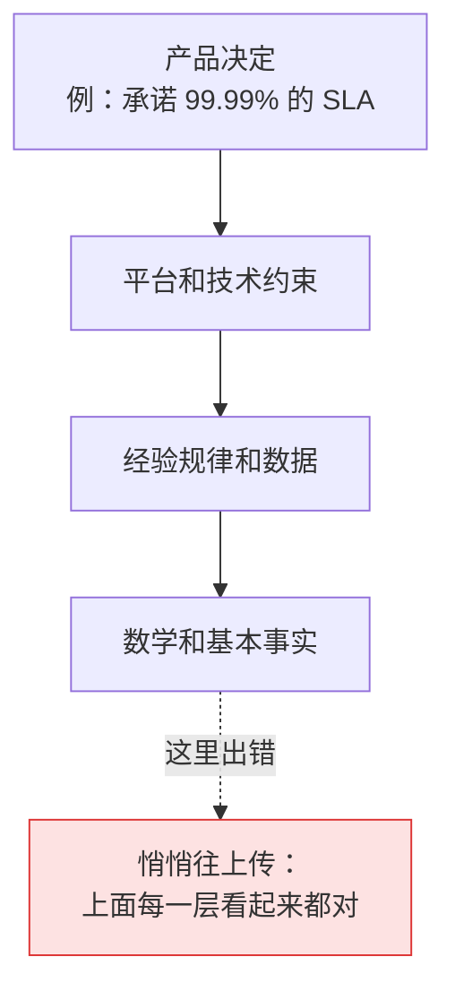
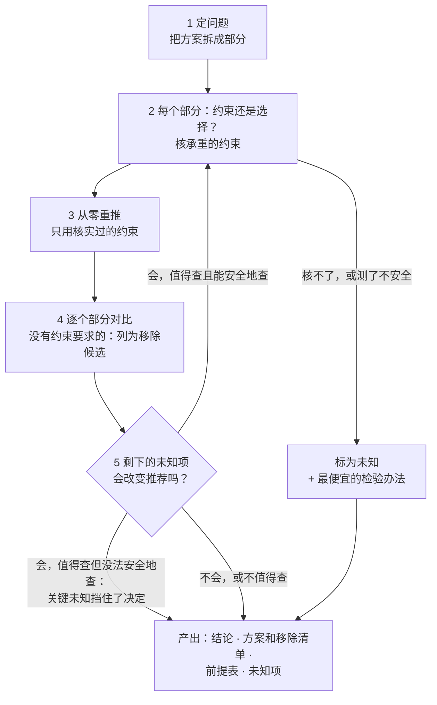
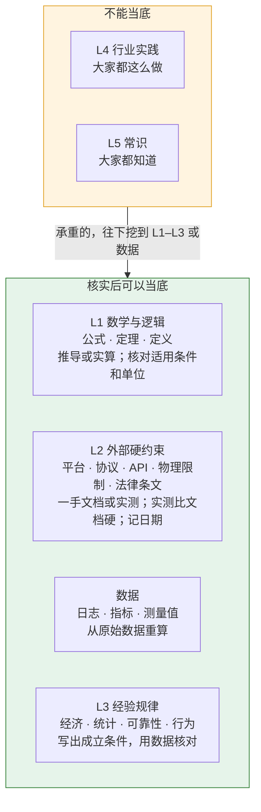
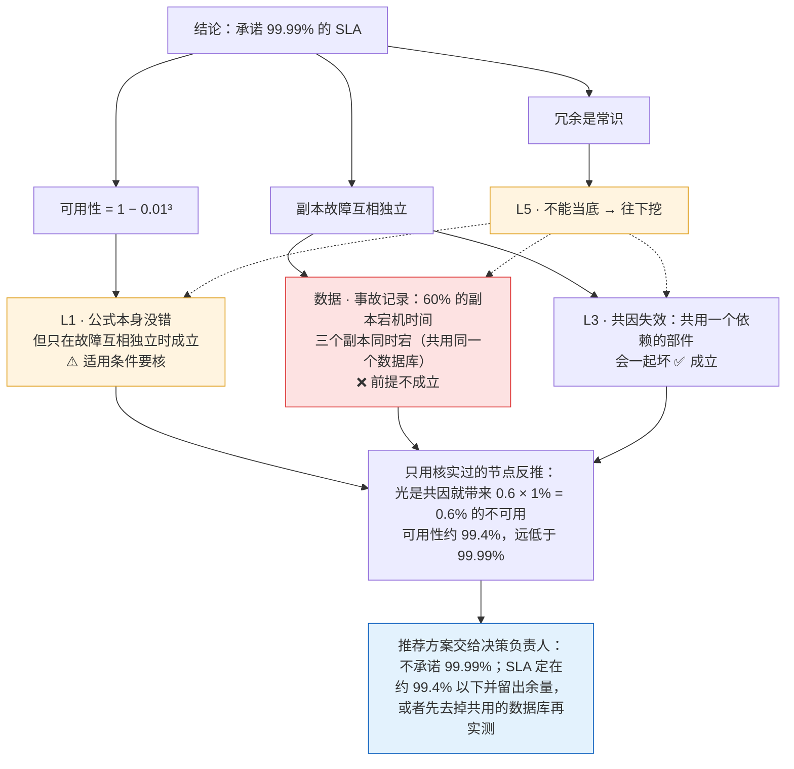

# 前提挑战（Premise Challenge）

**按方案真正站在什么上，重新推一遍方案。用一手证据核实约束，约束要求的部分都保留，其余列为移除候选；或者确认现方案站得住。它的设计目标是只在要紧的地方挖，再挖也不会改变答案时就停。**

[English](README.md)

一个 Claude Code 和 Codex 都能用的技能，手动开启（Claude Code 里输入 `/premise-challenge`，Codex 里输入 `$premise-challenge`）。给它一个问题，或者一个已经定下来的结论：一个决策、一份规格、一个方案，或者一份 *foundation*（写明一个产品是什么、建立在哪些规则之上的基础文档）。它对每条承重前提追问：*它凭什么成立？它又站在什么上？* 它会越过平台事实继续往下挖，挖到数学、数据、经验规律、行业实践和常识，逐层核实，告诉你错在哪一层。然后只用核实过的约束重新推出方案，再逐个部分对比：没有约束要求的部分列为移除候选；每个部分都有约束要求，就确认现方案。推荐交回给*决策负责人*，也就是当初做这个决定的人。

## 解决什么问题

执行时，决策和 foundation 文档必须被当作权威，否则工作永远没法收敛。代价是：前提一旦写进去，就没人再验证。而前提是分层的，下层一错，上层会跟着错得很完整、很自洽。在错的前提上继续优化，只会把错的方向做得更好。



*箭头读作"站在……之上"。* 这个技能就是一个开关，意思是：*先别往下做，回头检查地基。* 它默认关闭，免得把日常工作变成无休止的质疑。

## 什么时候用

| 适合 | 例子 |
|---|---|
| 重要决定要落地，或者要在它上面继续做 | `/premise-challenge design.md 里的 SLA` |
| 结论靠"大家都这么做"撑着 | `/premise-challenge "写操作一律走队列"这条规则` |
| 供应商或文档说"做不到""必须这样" | `/premise-challenge 供应商说 X 做不到的说法` |
| 上线前，检查核心说法或风险假设 | `/premise-challenge 定价页上的承诺` |
| 修复方案是给某个坏状态加处理 | `/premise-challenge 那个修复任务方案` |
| 直觉觉得哪里不对，又说不出来 | `/premise-challenge <那个结论>`，并让它摊开前提表 |

不适合：日常改代码、写文案、脑暴（发散阶段不该被前提卡住）；也不适合用来理清*你自己*想要什么。它质疑的是结论，不是提问的人。

## 安装

它用的是开放的 [Agent Skills](https://agentskills.io) 格式，**Claude Code** 和 **Codex** 都能用。只能手动调用，不会自己启动。

**Claude Code**

```sh
git clone https://github.com/zk-hypersolid/premise-challenge.git ~/.claude/skills/premise-challenge
```

输入 `/premise-challenge <靶子>`。只想给某个项目用，就把文件复制到那个项目的 `.claude/skills/premise-challenge`。

冷启动步骤还要装附带的 subagent，它被设置为不加载 CLAUDE.md 文件（`omitClaudeMd: true`）：

```sh
cp ~/.claude/skills/premise-challenge/agents/cold-designer.md ~/.claude/agents/
```

**Codex**

```sh
git clone https://github.com/zk-hypersolid/premise-challenge.git ~/.agents/skills/premise-challenge
```

输入 `$premise-challenge <靶子>`，或者在 `/skills` 里选。只想给某个项目用，就放到那个仓库的 `.agents/skills/premise-challenge`。冷启动用的 subagent 是 Claude Code 的功能；在 Codex 里，`cold-start.md` 要求 agent 直接说明这一步用不了，不拿别的东西顶替。

**中文版**：留一份源码副本，从里面装中文文件。把 `<技能目录>` 换成 `~/.claude/skills`（Claude Code）或 `~/.agents/skills`（Codex）：

```sh
git clone https://github.com/zk-hypersolid/premise-challenge.git ~/src/premise-challenge
mkdir -p <技能目录>/premise-challenge
cp ~/src/premise-challenge/zh-CN/*.md <技能目录>/premise-challenge/
cp -R ~/src/premise-challenge/scripts ~/src/premise-challenge/agents <技能目录>/premise-challenge/
```

**更新**：运行 `git -C <技能目录>/premise-challenge pull`。中文版先在 `~/src/premise-challenge` 里 pull，再把上面的复制命令跑一遍。如果已经有一个叫 `premise-challenge` 的技能，先把它移走。

**"只能手动调用"是怎么实现的**：Claude Code 读 `SKILL.md` 里的 `disable-model-invocation: true`；Codex 读 `agents/openai.yaml` 里的 `allow_implicit_invocation: false`。其他支持 Agent Skills 的工具也能加载 `SKILL.md`，但如果它们没有类似的设置，可能会自己启动这个技能；这些工具没有测过。

## 它怎么工作



1. **定问题，拆现方案**：把现方案拆成部分（环节、状态、机制、任务），按加入的顺序列出来。
2. **分清约束和选择**：约束是改不了的，包括数学、外部系统的实际行为、数据、经验规律，标层级并核实；选择是改得了的，包括自己的代码、配置、操作顺序、决策负责人拍板的事。行业实践和常识不算约束。只核承重的。
3. **从零重推**：只用核实过的约束。方案里每个部分都要能指出哪条约束要求它，也就是少了它，就会出现一个有证据的坏状态。能让坏状态不出现，就不去处理它。没有证据的担忧写进风险，不变成新的部分。
4. **逐个部分对比**：现方案里没有约束要求的部分，不再当作前提，列为移除候选，并写出它原本补的坏状态、那个状态为什么不再出现。
5. **收口**：每个部分都有约束要求，或者新方案好不到超过换方案的成本，就保持现方案。剩下的未知项都不会改变推荐时就停；只有错了的代价高于查的成本才去查，值得查但没法安全地查，结论写"关键未知挡住了决定"，并给出两种结果各自的方案。

简洁是推出来的结果，不是要追的指标：约束要求的部分，再多也保留。

## 层级：表示硬度，不表示深度



| 层 | 包括 | 怎么核 |
|---|---|---|
| **L1** 数学与逻辑 | 公式、定理、定义 | 自己推一遍，或代入本例的数字实算。核对引用的公式是不是那个定理本身、条件是否满足、单位是否一致。只引用不算核过。 |
| **L2** 外部硬约束 | 平台、协议、API 的实际行为；物理限制；法律条文 | 一手文档、规范、源码、日志、实测。记下日期和版本。实测比文档硬。 |
| **数据** | 日志、指标、测量值、实测记录 | 从原始数据重算，注明来源和区间。 |
| **L3** 经验规律 | 经济学、统计学、可靠性工程、行为规律 | 写出成立条件，用数据核对我们是否满足。 |
| **L4** 行业实践 · **L5** 常识 | 别人的做法、"大家都知道" | 不能当底。写出出处和适用条件；承重的，往下挖到 L1–L3 或数据。 |

不在层里的节点：**内部选择**（决策负责人拍板的事，以及我们自己的代码、配置和操作顺序，它们可以改）和**推断**。L4、L5 单独永远不能推翻 L1–L3、数据或实测。不质疑定理、物理定律和法律条文本身，只核对它们有没有被正确引用和使用。

## 一个完整的例子

某份设计文档写着：*"服务跑在 3 个副本上，每个副本可用性 99%。副本故障互相独立，所以服务可用性是 1 − 0.01³ = 99.9999%。因此可以承诺 99.99% 的 SLA。依据：冗余是常识。"*



公式从来没错，错的是它的适用条件。引用一个正确的公式不等于核过它。同样的方法也能挖开行业实践。"所有写操作都走消息队列，因为用队列解耦是最佳实践"，挖下去会落到队列值得用的条件上：写入量大或波动大，或者有多个独立的消费方。如果数据显示每天只有 40 次左右的写入、只有一个消费方，队列只会多一个环节、多一个故障点和额外的延迟，这条实践在这里就不适用。

**先消除，再修补。** 某个注册流程先建一个存储桶，开始往里复制初始文件，然后再开版本控制。约 3% 的桶最后没开上版本控制，团队准备写一个每晚运行的修复任务。往下挖发现：桶里只要有文件，服务商就拒绝开版本控制；日志里每一次失败，都是文件先到的桶。这个坏状态来自两个步骤的先后顺序。先开版本控制（大约 80 毫秒），这个状态就不会出现。已经受影响的桶，还要一次性迁到新建的、开了版本控制的桶里；不需要每晚跑的任务。（这里的服务商是虚构的，真实的存储服务各有不同。）

## 产出示例

已发布技能的一次真实运行（Claude Opus，Claude Code 2.1.287），有删节。仓库是虚构的，对应上面"先消除，再修补"的例子。其中 `design.md` 把现在的流程记为决策 D-0409，把修复任务方案记为 P-12。输入：`/premise-challenge design.md 里的 P-12`。

<details>
<summary>展开产出</summary>

**问题**：约 3% 新工作区一直处于"active、versioning 关"的状态，付费版"撤销 / 恢复任意文件"对它们失效。

**结论**：推荐改成调换 D-0409 的第 2、3 步，先开 versioning 再开始 seeding；P-12 的夜间修复任务和"重试 versioning"按钮都不做。已经卡住的工作区做一次性迁移。

#### 方案

**做什么**
- 建桶 → `PUT versioning` 拿到 200 → 再开始 seeding。
- 已有的约 3% 卡住的工作区，按 P-12 的"新建桶 → 开 versioning → 复制对象 → 切换指向 → 删旧桶"手动跑一次。之后不会再有新的卡住工作区，所以这是一次性的，不需要每晚跑。

**移除**
- 夜间修复任务。它补的是"每天都有新的工作区卡住"这个状态。调换顺序后，调用 versioning 时桶一定是空的，这个状态不会再出现。它自带的坏状态（复制过程中用户还在写入、切换和删桶的竞态、卡住到当晚修复之间没有 versioning）也一并消失。
- "重试 versioning"按钮。它补的是"409 只是暂时错误，重试能好"这个假设，而这个假设不成立：探针 Run C 里，有对象的桶 10 分钟内重试 5 次，5 次都是 409。这个按钮永远不会成功。

**站在哪几条约束上**：C1（桶里有对象时 versioning 返回 409，而且一直是 409）、C2（3.1% 的 409 全部是 seeding 先完成的情况）、C3（1.5 s 首屏目标调换后仍然满足）。证据见下表。

**风险**
- 首屏会多等一次 versioning 调用，沙箱数据是 p50 78 ms、p99 140 ms。即使这段时间全部叠加到首屏上，p95 也只是从 1.24 s 变成约 1.38 s，仍低于 1.5 s。但生产环境的 versioning 延迟没有实测过。
- 一次性迁移会写生产数据，期间用户可能在写入。迁移时要冻结写入，或者选低峰时段。

**可逆性**：调换顺序只是改代码，随时可以改回来。

**最便宜的验证**：在 provider 沙箱里跑"建桶 → PUT versioning → 上传 12 个文件"，确认返回 200 且对象带版本；在预发环境量一次首屏 p95。

*（前提表和未知项略）*

</details>

## 安全边界

- **不改东西**：技能要求 agent 不改任何文档、决策或代码，推荐方案交给决策负责人。这是一条指令，不是权限设置，所以请保持你所用 agent 的工具审批开着。
- **只做安全的实测**：只用只读操作，或者在测试环境里做（沙箱、预发环境、本地样例数据）。会写生产系统或生产数据、动真实资金、用生产凭证或密钥、做部署、给真实用户发消息的，一律不跑，标为*未知*交还给你。仓库里已有的脚本，agent 要先读过、确认不做这些事才会跑。
- **防止硬造疑点**：推翻必须带证据，即推导、一手来源、实测或数据。"可能已经改了""文档很旧了"都不算证据。

## 包含什么

- [SKILL.md](SKILL.md)：方法、层级、收口规则和产出格式。
- [cold-start.md](cold-start.md)：怎么先得到一版不受锚定的方案，再做对比。
- [scripts/make-clean-room.sh](scripts/make-clean-room.sh)：导出一个 git ref，并删掉清单里列出的 agent 指令文件、文档、设计说明和决策记录。
- [agents/cold-designer.md](agents/cold-designer.md)：Claude Code 用的 subagent，只根据 brief 做设计、不加载 CLAUDE.md 文件。
- [agents/openai.yaml](agents/openai.yaml)：Codex 的设置，让 Codex 不会自己启动这个技能。
- [zh-CN/](zh-CN/)：SKILL.md 和 cold-start.md 的中文版。

## 怎么测的（非正式）

以下是作者在本地做的非正式测试。用例、运行记录和评分标准都没有公开，结果只能当作参考。

- 设置：在隔离环境里（不加载其他指令文件）用 4 个模型测试，另由一个模型按固定评分标准盲评（评分时不知道是哪种条件跑出来的）。
- 用例：产品决定背后一条关于外部平台的错误前提；一份本来站得住、不该被动的 foundation；一个适用条件不满足的公式，加上和它矛盾的数据；一个本来正确、不该被怀疑的公式；一条在当前条件下不适用的行业实践。
- 上一版（以质疑为主）在最强的几个模型上：除一个用例外全部通过。没通过的那个用例里，它对一个本来成立的说法提出了一个边缘情况的担忧，评分标准记为未通过。
- 当前版本（以给出方案为主），在两个强模型上，用的是作者本地的这一版中文稿（不是本仓库里的文件），评分方式同上：上面 5 个用例每个模型各跑 1 次，成绩和上一版相同（各 9/10，各有一次边缘情况的失分）。另外新加了两个用例：计划中的修复方案在处理一个由操作顺序造成的坏状态，一个请求是评审这个修复方案，另一个是把修复任务做得更快。2 个用例 × 2 个模型 × 3 次，两版每次都推荐改顺序（共 24 次，每版 12 次）。所以在单一任务的短会话里，新写法没有测出提升；它针对的是长会话里的漂移，这些测试复现不了。当前版本 22 次运行里有 21 次以推荐方案开头（按有没有这一节做文本检索统计），篇幅比上一版长 5–20%。之后按一次外部审核改写了收口规则（只有错了的代价高于查的成本才去查未知项；可逆的决定，错了的代价就是改回来的成本）。新加的一个用例里，有一个承重、查起来慢、但改回来很便宜的未知项：新旧两种措辞在 12 次运行里都推荐先用金丝雀推进，而不是等着；三个旧用例仍然通过（6/6）。所以这次改动去掉了文字里的一处矛盾，但测试没有看到旧措辞真的造成问题。
- 做减法这一轮（上面的方法：把方案拆成部分、从约束重推、逐个对比）。新用例：周报邮件重复发送，前后四轮分别打了补丁：分布式锁、锁心跳、去重表、重试队列。难的条件是：先让模型在多轮对话里自己提出这些补丁并被采纳，之后服务商支持了幂等键，再调用技能。两个版本都找到了幂等键（Opus 和 Fable，用的是作者本地的中文稿）。上一版 6 次里 2 次给出完整移除清单，2 次没有新增机制；这一版 6 次里 5 次给出完整移除清单，6 次都没有新增机制，整体 6 次通过 5 次，没过的那次把锁和锁心跳标成"可以留着"而不是删掉。一个用来防止"删过头"的用例，后来发现本身有更简单的正确答案，没有测到东西。旧用例上成绩和之前一样，只在"本来站得住的方案"用例上多失分一次（Opus 3 次里 1 次）。
- 做减法之前发布的那版公开文本（中英文两份），在 Opus 和 Fable 上，上面 8 个用例各跑 1 次：32 次通过 29 次。3 次失分都在那个"公式本来正确"的用例上：评分标准期待"站得住"，技能的结论是"关键未知挡住了决定"，理由是按样本量，数据排除不了公式需要的那个条件。我们按失分计，但它的论证有实在的依据。现在仓库里的这两份文件在 Opus 上跑过 3 次（英文版跑了顺序用例和重复邮件用例，中文版跑了顺序用例），3 次都通过，上面的产出示例就是其中一次。还没有做更大范围的运行。
- 早一版与"不装技能、只说'挑战一下这些前提'"相比，各跑 8 次：找出错误前提 7/8 对 5/8；放过本来成立的前提 7/8 对 4/8。这个样本量下两项差距都不显著。之后的两版都没有和这个基线比较过。
- 没有看到的效果：分层没有让强模型挖得更深，它们被要求挑战前提时本来就会挖。这个技能想补的是刹车（少硬造疑点）、建立在核实过的前提上的推荐方案，以及稳定的产出格式；上面的结果对前者只是有迹象，不能算证实。安全边界没有测过。
- 小模型更常硬造疑点。这个技能请用强模型。
- Codex CLI 0.162.1，技能装在用户技能目录里，任务内容和技能描述吻合、但没有点名：没有 `agents/openai.yaml` 时，Codex 2 次里 2 次自己启动了技能；有它时 2 次里 0 次。用 `$premise-challenge` 点名调用时，它加载了技能、按技能的产出格式回答，没有改任何文件。
- cold-designer 这个 subagent 在 Claude Code 2.1.287 上做过一次金丝雀检查：项目的 CLAUDE.md 要求每次回答都以一个标记词开头，subagent 的回答里没有这个标记词。只检查了 CLAUDE.md，MCP 服务器说明、hook 输出等其他上下文没有检查。在你的版本上请再检查一次。

## 许可证

MIT，见 [LICENSE](LICENSE)。
